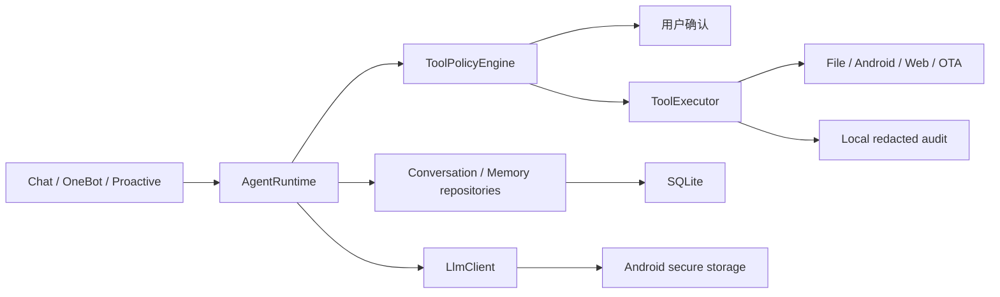

# Solvhen Architecture

本文档描述公开 Beta 主线的边界与不变量。代码行为与测试优先于本文档；涉及数量的内容应由代码或测试产生，不手工维护易漂移计数。

## 1. Runtime



主 Agent 状态机：

```text
idle → planning → awaitingApproval → executing → streaming
  └──────────────────────────────→ completed / cancelled / failed
```

运行不变量：

- 每次发送创建独立 `AgentRunSession`，配置在运行开始时形成快照。
- 运行同时受工具步数、有限循环数和真实截止计时器约束。
- 取消会传播到当前运行和工具上下文；新的对话不会继承旧运行状态。
- 到达预算时只能进入下一轮或停止工具并总结，不能悄悄突破硬上限。
- 未完成运行在恢复时标记中止，不自动重放副作用。

## 2. Execution configuration

`AgentExecutionConfig` 持久化主 Agent 的运行参数：

- `stepsPerLoop`: 每轮工具步数
- `maxLoops`: 有限循环数量
- `loopMode`: `ask` / `automatic` / `single`
- `timeoutMinutes`: 单次运行截止时间

所有输入在读取和保存时归一化到代码规定范围。理论工具上限为 `stepsPerLoop × effectiveLoops`。

子 Agent 是独立安全域：使用较小固定预算和外层超时，不继承主 Agent 的循环预算。缺少显式 `toolsets` 时是纯文本任务；声明工具集后也只暴露支持 `subAgent` 来源的只读条目。

## 3. Tool security

每个工具由以下元数据共同决定是否可见、是否可执行：

- `ToolRisk`: `read`, `modify`, `external`, `destructive`
- `capabilities`: 安全中心可撤回的能力集合
- `supportedOrigins`: 可调用该工具的来源集合
- `ToolContext`: request、来源、取消、会话和父工具

所有执行都调用 `ToolRegistry.dispatch`，并由 `ToolPolicyEngine` 决策 `allow`、`confirm` 或 `deny`。动态工具的嵌套调用使用 `ToolContext.nested` 再次 dispatch，不能直接跳过策略。

动态工具注册器只接受受限 DSL：必须声明能力，只能调用已注册且能力匹配的工具，并禁止代码执行、动态注册、开发工具和递归委派。注册确认面板展示 DSL 与能力声明；运行时每个嵌套调用都改用 `dynamicTool` 来源重新 dispatch。

安全不变量：

- 能力被关闭后，信任模式也不能恢复它。
- `destructive` 以及策略列出的系统/删除/安装类工具始终确认。
- OneBot 和主动任务使用固定只读集合。
- 子 Agent 即使在信任模式中也不能修改设备或数据。
- 子 Agent 不能再次委派子 Agent。
- 审计参数对 key、token、消息正文、代码和路径相关内容脱敏。

## 4. Storage and secrets

- SQLite 保存对话、记忆、人格、非敏感设置、运行记录、能力选择和审计事件。
- 模型 Key、OneBot token、开发服务器 token 等敏感值由安全存储管理；SQLite 只保留非敏感配置或迁移标记。
- 数据库打开并发通过共享 Completer 合并。
- 打开或迁移失败时尽力备份并上抛错误，绝不因普通错误自动删除数据库。
- 诊断导出不包含消息正文、密钥和文件路径。

## 5. Network origins

- 模型请求只使用用户配置的 OpenAI-compatible 端点。
- OneBot 默认关闭，只面向同一局域网并要求 token 与连接限制。
- OTA 未配置时不联网；配置后只允许固定官方 HTTPS 主机。
- 主动任务的来源与本地聊天不同，不能获得本地用户权限。
- OneBot 尚未配置 WSS 证书时必须由用户单独开启“明文局域网连接”，不能随普通启用开关自动降级。
- 开发者重建通道只允许回环/私网地址，要求 256 位 token、一次性 nonce、来源 IP/可选白名单和每次确认；默认服务器只监听回环地址。

## 6. Background scheduling

- 应用前台使用 `Timer`；进入后台后释放前台定时器。
- 周期不少于 15 分钟使用 Android WorkManager。
- 1–14 分钟周期必须显式确认并运行前台服务，同时显示常驻通知。
- UI isolate、WorkManager 与前台服务通过 SQLite 事务原子领取时间槽，防止同一周期重复执行。
- 已领取但未完成的任务不会在同一时间槽自动重放。

## 7. UI identity

- 基础页面使用暖白/低饱和深蓝/青绿与静态点阵，不使用纯黑页面底色。
- 状态眼睛是 logo 与运行状态反馈：顶栏小眼睛固定居中，回复末尾允许第二个小眼睛。
- 空状态不展示大眼睛。
- 背景点阵为低成本静态绘制；工作状态动画必须可释放定时器，不能因极端间隔溢出。
- 设置页不预创建 WebView，降低 MIUI 对话切换黑屏风险。
- 动态画布 WebView 只短时挂载；截图成功、渲染超时、切换对话、打开抽屉或进入设置后，在下一帧释放控制器并清空待执行 HTML 队列。
- 助手最终回复以单条语义消息持久化并使用 GFM 富文本展示；流式片段不解析未闭合 Markdown，用户主动上滑时暂停自动跟随。
- Markdown 图片不自动联网，HTTP(S) 链接仅在用户点击后交给外部浏览器。

## 8. Release gates

每个 release 至少执行：

```text
flutter analyze
flutter test
flutter build apk --release
```

公开 Beta 还需满足：

- 权限矩阵、循环预算、取消、SSE 任意分片、嵌套策略测试通过。
- 历史数据库夹具迁移后数据计数一致，明文密钥不存在。
- 真机验证新建/切换对话不黑屏，眼睛无遮挡与崩溃。
- OneBot 非法 token、来源 IP、消息大小和速率被拒绝。
- OTA 清单签名、APK 哈希、包名和签名证书全部验证；缺少发布公钥时保持锁定。
- 诊断包只由用户主动导出且内容脱敏。

自动化门槛已包含历史数据库夹具、OneBot token/IP/消息大小/连接数/速率限制、动态工具嵌套策略、主动调度去重和开发服务器 token/nonce 测试。首次公开 Beta 仍需使用正式签名配置完成人工真机升级、权限撤回、离线启动和诊断导出验收；若要默认提供加密 OneBot，还需部署 WSS 证书，否则只能保留用户单独开启的明文可信局域网模式。
